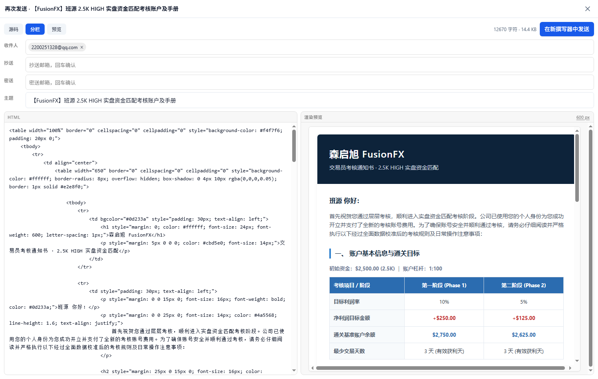
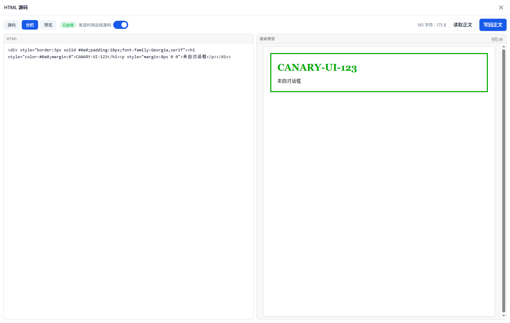
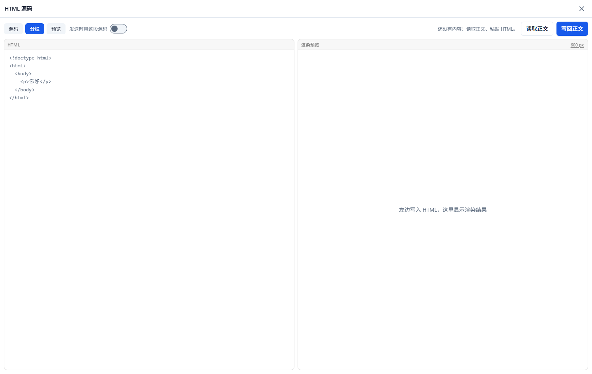

# HTML Source — raw HTML editing for Bulwark Webmail

A plugin for [Bulwark Webmail](https://bulwarkmail.org) that opens the message you are
composing as **raw HTML**, shows the **rendered result side by side**, and — if you turn the
switch on — sends that source **byte for byte** instead of the re-serialised rich-text body.



Bulwark's composer is a Tiptap editor with two modes, rich text and plain text. There is no
source view, and a message written by another client gets re-formatted the moment Bulwark
touches it (paragraph spacing, `<br>` inside empty paragraphs, and so on). This plugin does
not try to teach the editor about HTML. It leaves the editor alone and swaps the body at the
very last moment — while Send is already in flight.

- **Full-screen dialog** opened from a `</>` button in the composer's bottom bar.
- **Source / Split / Preview** — preview renders inside a sandboxed iframe, live as you type.
  A width switch toggles the preview between a 600 px mail column and the full pane.
- **Addresses as chips** — in Send again mode, To, Cc and Bcc are editable pills: type a
  beginner, press Enter or comma, click the × to drop one. Subject and attachments are editable too.
- **Send this source** — the HTML you see is the `text/html` part; the editor body is replaced
  with a notice so you can never mistake one for the other.
- **Send again** — open a message you already sent, press **Send again** in the reader toolbar,
  edit its original HTML, change the recipients, send. The markup comes back out as it went in,
  not as Tiptap's idea of it.
- **No privileged tier, no raw MIME.** It uses the ordinary outgoing-message transform hook.
- **Chinese and Traditional Chinese UI** included (plus English).

## Requirements

| | |
|---|---|
| Webmail | Bulwark **1.15.0+**, **full edition** |
| Plugin system | enabled by the administrator |
| Node.js | only if you build the zip yourself (≥ 18) |

The Lite build pins the plugin system off (`data-bulwark-lite-entry`, `pluginsEnabled: false`
in `policy.json`), so a static Lite deployment cannot load this plugin. There is no way around
that from the client side — it is a build-time decision.

## Install

Build the zip:

```bash
git clone https://github.com/Aloento/bulwark-html-source
cd bulwark-html-source
node pack.mjs          # -> dist/html-source-<version>.zip  (manifest.json + index.js at the root)
```

Then, in the webmail: **Admin → Plugins → Upload**, pick the zip, enable it. Reload the mail
page. The `</>` **HTML source** button appears in the composer's bottom bar, next to Attach,
Templates and Options.

The zip is about 19 KB: there is no bundler, no dependency and no build step — the bundle is
plain CommonJS that the host evaluates, with React and the UI kit supplied by the host.

## Use

1. Write a message and press **HTML source** (`</>`), or paste HTML that arrived from
   somewhere else. Everything lives on one row: view switch and the send toggle on the left,
   size and the primary action on the right; `Ctrl`/`Cmd`+`Enter` runs the primary action.
2. Edit on the left. **Split** keeps the rendered preview next to it; **Preview** gives the
   preview the whole width.
3. **Read body** pulls the current editor content into the source pane. **Write back** pushes
   the source into the editor — useful when you only want the editor to hold the markup. Note
   that Tiptap re-formats what it is given, so this is not a lossless round trip; that is what
   the switch is for.
4. Flip **Send this source** when the source pane is what should actually go out.



While the switch is on, the composer body is replaced with a notice saying that the message
will be sent as the source. Switch it off and the previous body comes back. The notice itself
is never sent — it exists only so the editor cannot show you something different from what
will arrive.



### What "Send this source" actually does

When the dialog is opened the plugin keeps a record for that composer window: the HTML, the
subject, and the recipients. On Send, the host hands the outgoing message to the plugin's
`onTransformOutgoingEmail` hook; if the subject and the recipient set still match, the plugin
returns the message with `htmlBody` replaced by your source (and a plain-text part generated
from it). The record is consumed and deleted, so it can never leak into a later message.
Records expire after 12 hours.

If the subject or the recipients changed after you armed it, the message is **not** rewritten:
you get a toast saying no source matched, and the editor body is sent. That is deliberate —
better to send the wrong body loudly than to send old HTML silently.

## Send again (resend an already-sent HTML message)

Open a message you sent, then press **Send again** in the reader's toolbar. The plugin asks the
host for the message's **raw RFC 5322 source** (`api.email.getRaw`), parses it itself — multipart
tree, base64 and quoted-printable, `charset` — and puts the `text/html` part in the same
full-screen dialog, this time with **To / Cc / Subject** fields at the top.

1. Edit the HTML if you want to; the preview updates as you type.
2. Change the recipients — that is the point: the source stays, the audience doesn't.
3. Press **Send in a new composer**. The composer opens with the recipients, the subject and a
   notice in the body; the source itself waits in the plugin's record.
4. Change anything else in the composer (signature, attachments) and press **Send**. The message
   goes out with your HTML.

Things worth knowing:

- **Inline images (`cid:`) are folded into the HTML as `data:` URIs.** A resent message gets
  fresh MIME part ids, so the old `cid:` references would dangle; the plugin fetches each inline
  attachment (up to a 3 MB budget) and inlines it. If a picture does not fit, the dialog says so.
- **Attachments are carried over by blob reference**, so they are the same bytes as the original.
- **The waiting record is matched by subject alone**, on purpose: the composer's body is a notice,
  and you are expected to change the recipients there. Change the *subject* in the composer and
  the plugin steps aside (toast, and the notice is what would be sent).
- The record lives for 2 hours and is deleted on the first matching send, or when that composer
  closes.

## Permissions

| Permission | Why |
|---|---|
| `ui:composer-toolbar` | the `</>` button in the composer bar |
| `ui:toolbar` | the **Send again** button in the reader toolbar |
| `ui:observe` | rendering the dialog slot |
| `compose:read` | reading the body and the composer snapshot |
| `compose:write` | swapping the body for the notice and back |
| `compose:open` | opening the composer that a resent message is assembled in |
| `email:read` | reading the sent message (recipients, subject, attachments), `onAfterEmailSend` |
| `email:blob-read` | the raw message source and inline images |
| `email:send` | `onTransformOutgoingEmail`, the hook that replaces the body |

No `tier: privileged`, no `crypto:full`, no `api.jmap.sendRaw`. The plugin never touches MIME,
SMTP or credentials: it hands the host a string, and the host's normal submission path carries
it.

## Limits

- **Full edition only.** Lite cannot load plugins at all.
- **Editor → source is lossy.** Read body gives you what Tiptap serialised, correct as far as
  Tiptap is concerned but not the original markup.
- **Armed messages are matched by subject + recipients.** Change either one before sending and
  the plugin steps aside. (A resent message is matched by subject only — see above.)
- **The plain-text alternative is generated**, by stripping tags, so text-only readers see a
  readable approximation rather than an alternative you wrote.
- **Attachments are untouched** — they are added by the host after the transform, so inline
  `cid:` images referenced from your HTML will ship as ordinary attachments, not as
  `multipart/related` parts. Keep images in the composer if that matters.
- **Remote images don't load in the preview** (the sandbox CSP only allows `data:` and `blob:`).
  That mirrors what many recipients see anyway.
- **1 MB of storage per account** for the source draft, and the editor body swap counts against
  the composer API's change budget (60 changes/minute).
- The dialog's own chrome — the "from plugin" line, the `⋮` menu, the 640 px height cap — is
  host code, not plugin API. See [docs/chrome.md](docs/chrome.md) if you want the full-screen
  look in the screenshot, which is done with a stylesheet on the server side.

## Build, test, package

```bash
node test.mjs      # 52 assertions, runs the bundle in a sandbox shaped like the host's
node pack.mjs      # writes dist/html-source-<version>.zip and validates the size limits
```

`test.mjs` loads `index.js` the way the host does — inside a function whose parameters include
`module`, `exports`, `require`, `React`, `ReactDOM`, `JsxRuntime` and `console` — then drives
the hooks with fake storage and a fake composer, asserting that a matching send is replaced
byte for byte, that an unmatched one is left alone, and that records are consumed and pruned.
It also feeds the MIME parser real multipart bodies (base64, quoted-printable, nested
`multipart/alternative`, UTF-8 subjects, folded headers) and checks the resend side of the
transform, which is matched by subject alone.
The host's wrapper is the reason `index.js` never declares `React` itself: a `const React`
at the top level of the bundle collides with the parameter and the whole bundle fails to
parse. That bug is in this repository's history; the test now reproduces it.

## Repository layout

```
manifest.json        plugin manifest (id, permissions, 3 locales)
index.js             the whole plugin, CommonJS, no build step
pack.mjs             zip writer (zlib, no dependencies)
test.mjs             host-shaped sandbox tests
chrome/              optional server-side CSS for the full-screen dialog
docs/                how it works, and the chrome override
screenshots/         resend, compose, empty
```

## License

MIT. Not affiliated with the Bulwark project.
